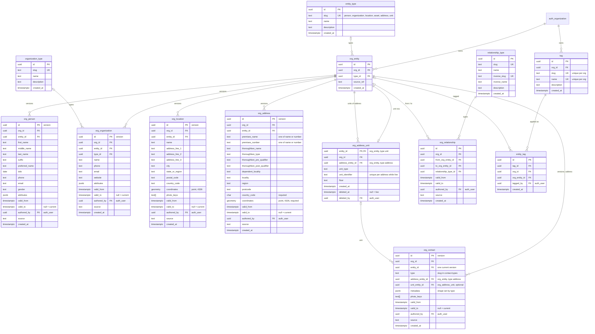
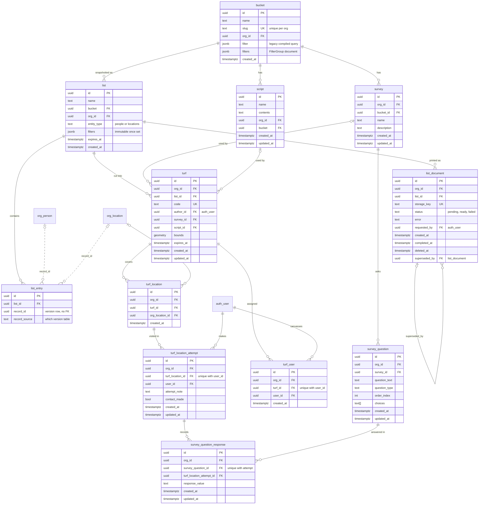
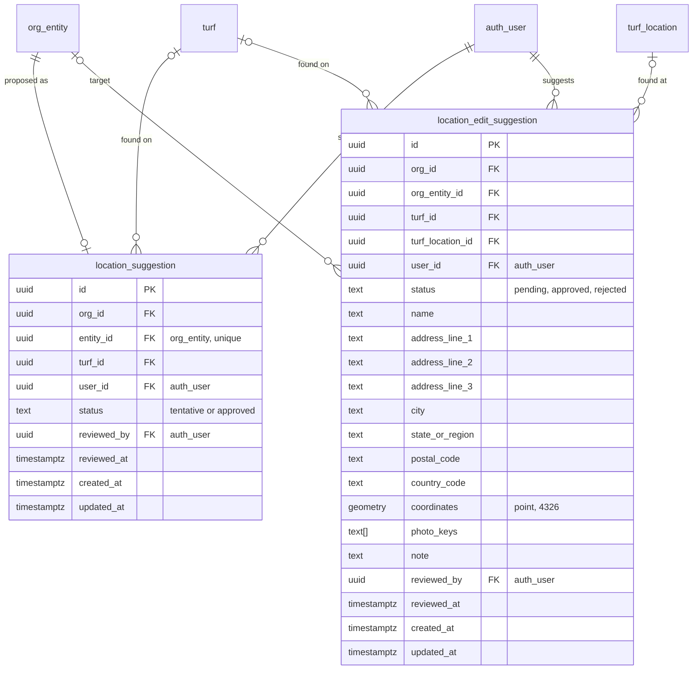

# Database Schema

Entity-relationship diagrams for the whole database, drawn from `src/lib/server/setup-schema.ts`. When that file changes, update this page.

There are three schemas:

| Schema | Tables |
|---|---|
| `auth` | Managed by better-auth: `user`, `account`, `session`, `verification`, `two_factor`, `organization`, `member`, `invitation`. Shown here with an `auth_` prefix. |
| `public` | Plugins, invites, permissions, and system configuration: `plugin_installation`, `org_invite_link`, `org_slug_invite`, `registered_permission`, `permission_role`, `permission_role_entry`, `user_role_membership`, `user_permission`, `system_setting`, `email_template`. |
| `universe` | Everything else: entities and their versions, relationships, tags, buckets, lists, surveys, turfs, canvassing results, suggestions, and list documents. |

Conventions used in the diagrams:

- Dotted lines are references with no foreign key constraint.
- Almost every table in `public` and `universe` has an `organization_id` or `org_id` pointing at `auth.organization`, and many have audit columns (`authored_by`, `granted_by`, `reviewed_by`, `requested_by`, ...) pointing at `auth.user`. The overview leaves those lines out; the detailed diagrams list the columns with an `FK` marker and draw only the lines that matter to the feature.

## Overview

Every table and how they connect, without columns.

```mermaid
erDiagram
    %% auth
    auth_user ||--o{ auth_account : ""
    auth_user ||--o{ auth_session : ""
    auth_user ||--o{ auth_two_factor : ""
    auth_user ||--o{ auth_member : ""
    auth_organization ||--o{ auth_member : ""
    auth_organization ||--o{ auth_invitation : ""
    auth_verification { uuid id PK }

    %% public: plugins, invites, permissions
    auth_organization ||--o{ plugin_installation : ""
    auth_organization ||--o{ org_invite_link : ""
    auth_organization ||--o| org_slug_invite : ""
    auth_organization |o--o{ permission_role : ""
    permission_role ||--o{ permission_role_entry : ""
    registered_permission ||--o{ permission_role_entry : ""
    permission_role ||--o{ user_role_membership : ""
    auth_member |o--o{ user_role_membership : ""
    registered_permission ||--o{ user_permission : ""
    auth_member |o--o{ user_permission : ""
    system_setting { text key PK }
    email_template { text key PK }

    %% universe: entities and versions
    entity_type |o--o{ org_entity : ""
    org_entity ||--o{ org_person : ""
    org_entity ||--o{ org_organization : ""
    org_entity ||--o{ org_location : ""
    org_entity ||--o{ org_address : ""
    org_entity ||--o| org_address_unit : ""
    org_entity ||--o{ org_contact : ""
    org_address_unit |o--o{ org_contact : ""
    organization_type |o--o{ org_organization : ""

    %% universe: relationships and tags
    relationship_type ||--o{ org_relationship : ""
    org_entity |o--o{ org_relationship : ""
    tag ||--o{ entity_tag : ""
    org_entity |o--o{ entity_tag : ""

    %% universe: buckets, lists, surveys, turfs
    bucket ||--o{ script : ""
    bucket ||--o{ list : ""
    bucket ||--o{ survey : ""
    list ||--o{ list_entry : ""
    org_person |o..o{ list_entry : ""
    org_location |o..o{ list_entry : ""
    list ||--o{ list_document : ""
    list_document |o--o{ list_document : ""
    list ||--o{ turf : ""
    survey ||--o{ survey_question : ""
    survey |o--o{ turf : ""
    script |o--o{ turf : ""
    turf ||--o{ turf_user : ""
    turf ||--o{ turf_location : ""
    org_location |o--o{ turf_location : ""
    turf_location ||--o{ turf_location_attempt : ""
    turf_location_attempt ||--o{ survey_question_response : ""
    survey_question ||--o{ survey_question_response : ""

    %% universe: field suggestions
    org_entity ||--o| location_suggestion : ""
    turf |o--o{ location_suggestion : ""
    org_entity |o--o{ location_edit_suggestion : ""
    turf |o--o{ location_edit_suggestion : ""
    turf_location |o--o{ location_edit_suggestion : ""
```

## Auth, membership, and permissions

Users, organizations, sessions, and the RBAC tables. A `permission_role` with no `organization_id` is an infrastructure role. `user_role_membership` and `user_permission` carry a `member_id` for org-scoped grants and none for infrastructure grants; triggers check that the member belongs to the user. Inserting into `auth.member` adds the org's default ("Everyone") role.

```mermaid
erDiagram
    auth_user {
        uuid id PK
        text name
        text username UK
        text display_username
        text email UK
        bool email_verified
        text image
        bool two_factor_enabled
        text role
        bool banned
        text ban_reason
        timestamp ban_expires
        uuid impersonated_by FK "auth_user"
        timestamp created_at
        timestamp updated_at
    }
    auth_account {
        uuid id PK
        uuid user_id FK
        text account_id UK "with provider_id"
        text provider_id UK
        text access_token
        text refresh_token
        timestamp access_token_expires_at
        timestamp refresh_token_expires_at
        text scope
        text id_token
        text password
        timestamp created_at
        timestamp updated_at
    }
    auth_session {
        uuid id PK
        uuid user_id FK
        text token UK
        text ip_address
        text user_agent
        uuid active_organization_id FK
        timestamp expires_at
        timestamp created_at
        timestamp updated_at
    }
    auth_verification {
        uuid id PK
        text identifier
        text value
        timestamp expires_at
        timestamp created_at
        timestamp updated_at
    }
    auth_two_factor {
        uuid id PK
        uuid user_id FK
        text secret
        text backup_codes
    }
    auth_organization {
        uuid id PK
        text name
        text slug UK
        text logo
        text metadata
        timestamp created_at
    }
    auth_member {
        uuid id PK
        uuid user_id FK "unique with organization_id"
        uuid organization_id FK
        text role
        timestamp created_at
    }
    auth_invitation {
        uuid id PK
        text email
        uuid inviter_id FK
        uuid organization_id FK
        text role
        text status
        timestamp created_at
        timestamp updated_at
    }
    plugin_installation {
        uuid id PK
        uuid organization_id FK "unique with plugin_slug"
        text plugin_slug
        bool enabled
        jsonb config
        uuid installed_by FK "auth_user"
        timestamp created_at
        timestamp updated_at
    }
    org_invite_link {
        text id PK
        uuid org_id FK
        uuid created_by FK "auth_user"
        timestamp expires_at
        timestamp created_at
    }
    org_slug_invite {
        uuid org_id PK, FK
        bool enabled
    }
    registered_permission {
        uuid id PK
        text key UK "unique with scope"
        text name
        text description
        perm_scope scope "organization or infrastructure"
        timestamp created_at
    }
    permission_role {
        uuid id PK
        text name
        int weight "unique per org"
        perm_scope scope
        uuid organization_id FK "null for infrastructure"
        bool is_default "the Everyone role"
        timestamp created_at
    }
    permission_role_entry {
        uuid id PK
        uuid role_id FK
        uuid registered_permission_id FK
        bool value
    }
    user_role_membership {
        uuid id PK
        uuid user_id FK "unique with role_id"
        uuid member_id FK "null for infrastructure"
        uuid role_id FK
        uuid granted_by FK "auth_user"
        timestamp created_at
    }
    user_permission {
        uuid id PK
        uuid user_id FK
        uuid member_id FK "null for infrastructure"
        uuid registered_permission_id FK
        uuid organization_id FK "null for infrastructure"
        bool value
        uuid granted_by FK "auth_user"
        timestamp created_at
    }
    system_setting {
        text key PK
        text value
        text description
        timestamptz updated_at
    }
    email_template {
        text key PK
        text subject
        text html_body
        jsonb variables
        timestamptz updated_at
    }

    auth_user |o--o{ auth_user : "impersonated_by"
    auth_user ||--o{ auth_account : "has"
    auth_user ||--o{ auth_session : "has"
    auth_user ||--o{ auth_two_factor : "has"
    auth_organization |o--o{ auth_session : "active in"
    auth_user ||--o{ auth_member : "belongs via"
    auth_organization ||--o{ auth_member : "has"
    auth_user ||--o{ auth_invitation : "invites"
    auth_organization ||--o{ auth_invitation : "has"
    auth_organization ||--o{ plugin_installation : "installs"
    auth_organization ||--o{ org_invite_link : "has"
    auth_organization ||--o| org_slug_invite : "has"
    auth_organization |o--o{ permission_role : "defines"
    permission_role ||--o{ permission_role_entry : "grants"
    registered_permission ||--o{ permission_role_entry : "granted by"
    auth_user ||--o{ user_role_membership : "holds"
    auth_member |o--o{ user_role_membership : "scopes"
    permission_role ||--o{ user_role_membership : "assigned in"
    auth_user ||--o{ user_permission : "holds"
    auth_member |o--o{ user_permission : "scopes"
    registered_permission ||--o{ user_permission : "granted in"
    auth_organization |o--o{ user_permission : "scopes"
```

## Universe entities

People, organizations, and locations. Each entity is a row in `org_entity`, private to one org, and its data lives in version rows. Nothing is shared between orgs. An edit closes the current version (`valid_to = now()`) and inserts a new one; the current version is the one with `valid_to IS NULL`. A trigger stamps the entity's `type_id` from the first version inserted and rejects versions of a different type.

Addresses follow the UPU S42 address elements for physical places (no addressee, no PO boxes). An address is versioned like the other entities, with one point of coordinates. A unit (apartment, suite, floor) is an entity with a single unversioned row in `org_address_unit`: it points at its address entity, not a version, so it survives address edits and is canvassed from the address's current point. A unit is soft-deleted with `deleted_at`. An address split off another keeps a `split_from` relationship to it.

A contact is anything canvassed at an address: a business today, a resident later. The kinds share one versioned table, `org_contact`, and differ only in `metadata`, whose shape each kind declares in `$lib/shared/contact-types` (the database only checks that it is a JSON object). A contact points at its address entity, and optionally one of its units, with foreign keys. Existing locations are being moved onto contacts (`scripts/backfill-addresses.ts`): each contact reuses its location's entity id, so the contract step can repoint lists and turfs by entity. Until then the app still reads `org_location`.

Two views read current versions only: `v_people` (`org_person`) and `v_locations` (`org_location`, hiding tentative location suggestions). Both are filtered by `app.current_org_id`.

## Buckets, lists, and canvassing

A bucket is a live filter over the universe. A list is a snapshot of a bucket: its `list_entry` rows point at the exact entity version rows that existed when it was made, and `record_source` says which version table `record_id` refers to (there is no foreign key). Turfs are cut from a list and point at those same location versions. `bucket.filters` and `list.filters` hold the filter editor document; `bucket.filter` is the older compiled query it replaces, and `list.filters` cannot change once set.

## Field suggestions

Canvassers can propose locations from the field. A new location is created as an `org_entity` with a `tentative` `location_suggestion` (at most one per entity), and stays out of `v_locations` until approved. A correction to an existing location goes in `location_edit_suggestion` with the proposed values; it targets an entity rather than a version, so it survives edits. Approving one writes a new version of the location.

